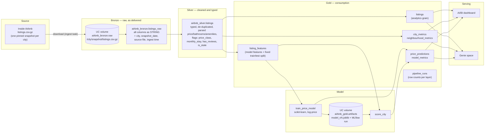

# Solution architecture

A medallion lakehouse on **Databricks Free Edition** (serverless compute, Unity Catalog,
catalog `workspace`). One parameterised pipeline is run once per city; adding a city means adding
one entry to [`src/airbnb/cities.json`](../src/airbnb/cities.json), never copying code.

## Layers

| Layer | Objects | Purpose | Write mode |
|---|---|---|---|
| Landing | volume `workspace.airbnb_bronze.raw` | the downloaded file, byte-for-byte, under `<city>/<snapshot_date>/` | file is only downloaded if missing |
| Bronze | `airbnb_bronze.listings_raw` | the CSV as delivered: every column `STRING`, nothing dropped or typed, plus lineage columns. Reprocessing never needs a new download. | per-city overwrite (`replaceWhere city = …`), schema merge |
| Silver | `airbnb_silver.listings` | one row per listing, typed and cleaned (EDA §6): money and booleans parsed, `bathrooms` from text, amenities as an array, outlier class, leak columns dropped, de-duplicated on `id` | per-city overwrite |
| Gold | `airbnb_gold.listings` | curated listing-level table for BI/Genie (no free text, no leak columns) | per-city overwrite |
| | `airbnb_gold.city_metrics`, `airbnb_gold.neighbourhood_metrics` | KPIs per city / neighbourhood: listings, median price, availability, review score, hosts, room-type mix | per-city overwrite |
| | `airbnb_gold.listing_features` | model-ready features, label, `is_trainable`, and the **fixed 80/20 split** (`hash(id) mod 100 < 20` → test) | per-city overwrite |
| | `airbnb_gold.price_predictions` | predicted vs actual price and baseline for every listing, per `model_version` | overwrite per (model version, city) |
| | `airbnb_gold.model_metrics` | MAE of model and baseline per model version, city, split | overwrite per (model version, city) |
| | `airbnb_gold.pipeline_runs` | row counts in/out of every layer per run — the audit trail used in the city C report | append |
| Artifacts | volume `workspace.airbnb_gold.artifacts` | fitted model (`models/<version>/model.joblib`, includes the baseline table) and its feature list; runs are also logged to MLflow | one folder per model version |

## Orchestration (Databricks Asset Bundle, [`databricks.yml`](../databricks.yml))

| Job | Parameters | Tasks |
|---|---|---|
| `airbnb_city_pipeline` | `city`, `snapshot_date` (optional), `catalog` | `setup` → `bronze` → `silver` → `gold` |
| `airbnb_etl` | `cities` (JSON list), `catalog` | `for_each` city → run `airbnb_city_pipeline` |
| `airbnb_train_price_model` | `train_cities`, `model_version`, `catalog` | run `airbnb_etl` for the training cities; then `train` (fits, evaluates on the test split, writes predictions + metrics, saves the model) |
| `airbnb_onboard_city` | `city`, `model_version`, `catalog` | run `airbnb_city_pipeline` for the new city → `score` with an existing model version |

The same notebooks run unchanged locally on Spark 4 + Delta through
[`scripts/run_local.py`](../scripts/run_local.py) (catalog `spark_catalog`, local folders instead of
volumes) — used for development and whenever the Free Edition compute quota is exhausted.

## Design decisions

* **Bronze is all strings.** The EDA showed text-encoded numbers (`$1,234.00`), JSON in cells and
  multi-line descriptions. Typing at read time would silently turn bad values into nulls; typing
  in silver with `try_cast` makes every conversion explicit and countable.
* **One table per layer, partitioned by city**, rather than one table per city: cross-city
  comparison is a `GROUP BY`, and re-running one city only rewrites its partition.
* **The split lives in gold, not in the model code.** It is a deterministic hash of the listing
  id, decided before any model was trained, so every number comes from the same test listings
  no matter how often the pipeline re-runs.
* **Model versions are explicit** (`v1`, `v2`, …). The city C first run must use the model as it
  was at the end of week 1, so models are never overwritten.
